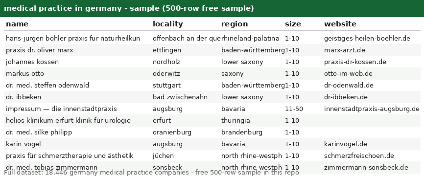

# Medical Practice in Germany -- Germany Company Dataset with LinkedIn URLs (18,446 Records)

Welcome! This is a clean, ready-to-use list of **18,446 medical practice companies across germany** -- perfect for lead generation, market research, and data projects. Browse the free sample below to see the quality before you buy.

## Get the data

| File | Rows | Format | Link |
|---|---|---|---|
| **Free sample** | 500 rows | CSV | [companies_sample500.csv](companies_sample500.csv) |
| **Full dataset** | **18,446 rows** | CSV + JSON | Buy on Gumroad -- $2 per 10,000 records ($4 total) -> **[GUMROAD-PENDING-QUOTA]** |

> Start with the [free 500-row sample](companies_sample500.csv) -- same columns, same format as the full file. If it fits your workflow, grab the complete 18,446-row dataset on Gumroad.

---

## What's in this repo

This repo contains a **free 500-row sample** of medical practice germany companies. The sample lets you inspect the schema and data quality before buying the full file.

- **`companies_sample500.csv`** -- 500 real records, free ([download](companies_sample500.csv))
- **`preview.png`** -- screenshot of the sample opened in a spreadsheet (above)
- **Full dataset (`companies.csv` + `companies.json`, 18,446 rows)** -- available on Gumroad (link above), *not* included here to keep this repo light

## Fields

| Column | Description | Example |
|---|---|---|
| `country` | Country (all rows: `germany`) | `germany` |
| `founded` | Year founded (may be empty) | `1998` |
| `id` | Opaque source record ID | `QzgWZ4YLJmG9sPQai5BB5Ajbmm1B` |
| `industry` | Industry (all rows: `medical practice`) | `medical practice` |
| `linkedin_url` | LinkedIn company page (domain + path) | `linkedin.com/company/hans-jürgen-böhler-praxis-für-naturheilkunde` |
| `locality` | City / town | `offenbach an der queich` |
| `name` | Company name | `hans-jürgen böhler praxis für naturheilkunde` |
| `region` | State / region (lowercase) | `rhineland-palatinate` |
| `size` | Employee-count band | `1-10` |
| `website` | Company website domain (may be empty) | `geistiges-heilen-boehler.de` |

**Notes:**
- `founded` and `website` are empty for some records.
- `size` values look like `1-10`, `11-50`, `51-200`, etc.
- CSV is UTF-8 with a header row; fields with commas are quoted.

## The full dataset (18,446 records -- on Gumroad)

- **18,446 germany medical practice companies**, same 10 columns as the sample
- Priced at **$2 per 10,000 records = $4 total**
- Delivered as `companies.csv` (+ JSON version) immediately after purchase
- Buy here -> **[GUMROAD-PENDING-QUOTA]**

## Use cases

Lead generation & prospecting | market sizing | competitive analysis | location analytics | data enrichment | ML training data | sales planning
